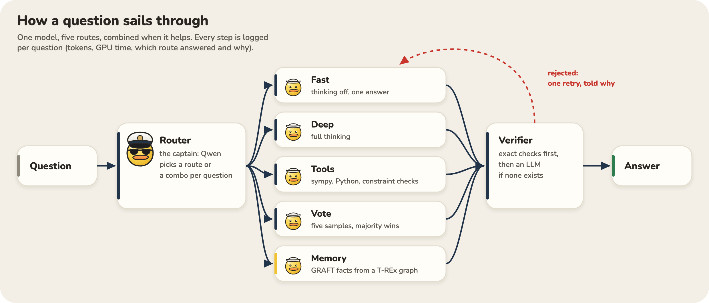
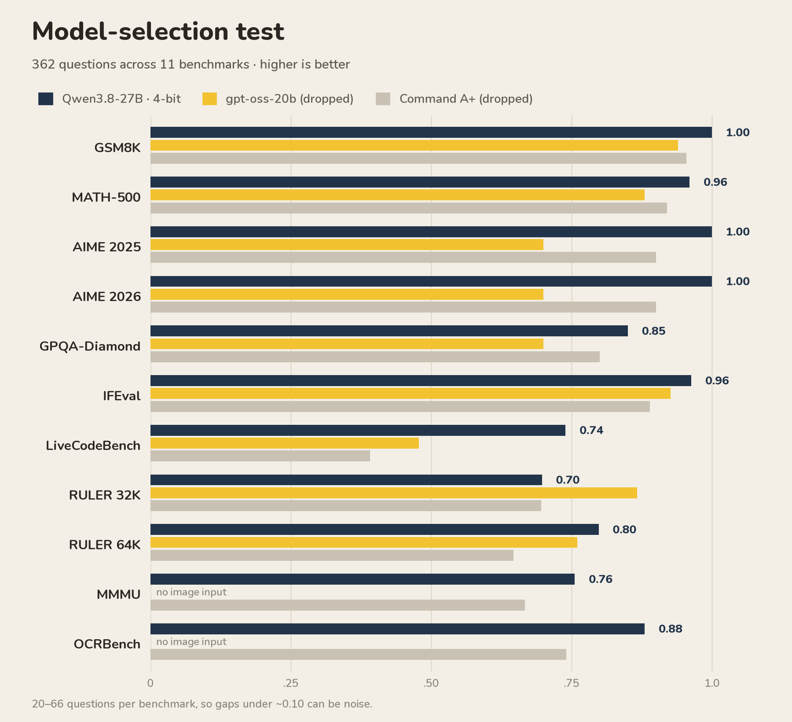

  

<h1 align="center">Flotilla</h1>

<b>One small, quantized open model that picks how to think, per question.</b> 
A compound system on a few H100s, measured on the same benchmarks and settings as published quantized results.

  
  
  
  

---

Flotilla started as a crew of models. The tests cut it to one: Qwen3.8-27B at 4-bit beat the others, and routing
between models added almost nothing. Now the captain (a router) picks a **route** for each question instead: answer
fast, think long, use tools, vote, or recall facts from a knowledge graph. Every rule for keeping or dropping a part
was written down **before** the scored run that decided it, so nothing is tuned on the test set.

## ⚓ At a glance

| | |
|---|---|
| **Model** | Qwen3.8-27B, 4-bit (W4A16, ours), text and images |
| **Small-test mean** | [**0.877**](experiments/test-02-model-small-test/table.csv) over 11 benchmarks |
| **Routes** | Fast, Tools, Deep, Vote, Memory (GRAFT), and combinations |
| **Now** | Labelling every route on 1,500 pool questions to train the strategy router |
| **Dropped** | Command A+ (rule 4.2), gpt-oss-20b (router gain under 1 point) |

## 🧭 How it works

1. **Router.** Reads the question and picks a route or a combination. Trained on questions where every route was tried.
2. **Routes.** Fast (thinking off), Deep (full thinking), Tools (`sympy`, Python, constraint checks), Vote (five
   samples, majority), Memory (facts from a GRAFT knowledge graph).
3. **Verifier.** Runs exact checks first and only asks an LLM when no exact check exists. If it rejects an answer,
   the route gets one retry and is told why.

Every step is logged per question: tokens, GPU time, which route answered, and why.

## 🦆 Why one model

| Test | Question | Result | Decision |
|---|---|---|---|
| [01](experiments/test-01-quantization/README.md) | 4-bit or 8-bit? | Qwen 4-bit [0.984](experiments/test-01-quantization/table.csv), 8-bit [0.984](experiments/test-01-quantization/table.csv) on MATH-500 | Qwen runs 4-bit |
| [02](experiments/test-02-model-small-test/README.md) | Which models? | Qwen [0.877](experiments/test-02-model-small-test/table.csv), gpt-oss [0.772](experiments/test-02-model-small-test/table.csv) (9 text), Command A+ [0.773](experiments/test-02-model-small-test/table.csv) | Command A+ dropped: [−0.104, CI [−0.143, −0.065]](experiments/test-02-model-small-test/rule_4_2.csv) |
| [03](experiments/test-03-router-b-models/README.md) | Route between Qwen and gpt-oss? | Router [0.899](experiments/test-03-router-b-models/table.csv) vs Qwen alone [0.895](experiments/test-03-router-b-models/table.csv) on 476 held-out | gpt-oss dropped |

## 📊 Strategy router (test 04)

The same model, six routes so far, on 50 pilot questions where every route answered every question.

| Route | Accuracy | Output tokens | GPU-s per question | Cheapest correct |
|---|---|---|---|---|
| Fast | [0.74](experiments/test-04-strategy-router/table.csv) | [2,110](experiments/test-04-strategy-router/table.csv) | [3.9](experiments/test-04-strategy-router/table.csv) | [37](experiments/test-04-strategy-router/table.csv) |
| Tools | [0.82](experiments/test-04-strategy-router/table.csv) | [2,615](experiments/test-04-strategy-router/table.csv) | [13.3](experiments/test-04-strategy-router/table.csv) | [6](experiments/test-04-strategy-router/table.csv) |
| Deep | [0.84](experiments/test-04-strategy-router/table.csv) | [6,058](experiments/test-04-strategy-router/table.csv) | [14.1](experiments/test-04-strategy-router/table.csv) | [2](experiments/test-04-strategy-router/table.csv) |
| Deep+Tools | [0.82](experiments/test-04-strategy-router/table.csv) | [6,291](experiments/test-04-strategy-router/table.csv) | [17.0](experiments/test-04-strategy-router/table.csv) | [0](experiments/test-04-strategy-router/table.csv) |
| Vote | [0.82](experiments/test-04-strategy-router/table.csv) | [21,821](experiments/test-04-strategy-router/table.csv) | [17.7](experiments/test-04-strategy-router/table.csv) | [0](experiments/test-04-strategy-router/table.csv) |
| Vote+Tools | [0.82](experiments/test-04-strategy-router/table.csv) | [19,995](experiments/test-04-strategy-router/table.csv) | [17.1](experiments/test-04-strategy-router/table.csv) | [0](experiments/test-04-strategy-router/table.csv) |

**So far:** Fast is the cheapest correct route on most pilot questions, and some route is right on
[90%](experiments/test-04-strategy-router/table.csv) of them against [0.84](experiments/test-04-strategy-router/table.csv)
for the best single route. That gap is what a router can win. All six routes have now answered the other 1,450
questions, but checking the failures by hand found bugs in the verifier's option check and in the instruction checker
([failure report](experiments/test-04-strategy-router/runs/run-02/audit/failure_report.md)). Those labels are fixed and
regraded before any router is trained. The four Memory routes follow the GRAFT run.

## 📜 Decisions

| Rule | Question | Outcome |
|---|---|---|
| 4.1 | 4-bit or 8-bit? | 4-bit if within 1 point of 8-bit; **Qwen runs 4-bit** |
| 4.2 | Keep Command A+? | **Dropped.** CI of the difference is below 0, on 4× the GPUs |
| v10 | Keep gpt-oss? | **Dropped.** Router gain [+0.004](experiments/test-03-router-b-models/table.csv), under the 1-point bar |
| test 04 | Keep the strategy router? | Pending. Kept if within 1 point of the best fixed route at lower compute, or more than 1 point better |

The full rules, the leakage checks and the changelog are in [`docs/PROTOCOL.md`](docs/PROTOCOL.md); every run and
decision is logged in [`docs/run_log.md`](docs/run_log.md).

## 🧪 Experiments

| Test | Question | Status | Decision |
|---|---|---|---|
| [01 · Quantization](experiments/test-01-quantization/README.md) | Does 4-bit lose accuracy? | done | Qwen runs 4-bit |
| [02 · Model small test](experiments/test-02-model-small-test/README.md) | Which models earn a place? | done | Command A+ dropped |
| [03 · Router B](experiments/test-03-router-b-models/README.md) | Does routing between models help? | done | gpt-oss dropped |
| [04 · Strategy router](experiments/test-04-strategy-router/README.md) | Does picking a route per question help? | running | pending |
| [05 · GRAFT base graph](experiments/test-05-graft-base-graph/README.md) | Does a base knowledge graph help Memory? | running | RoG base not adopted |

Index and rules for adding a test: [`experiments/INDEX.md`](experiments/INDEX.md). Charts are drawn only from
[`results/tables/`](results/tables/) by [`docs/design/charts.py`](docs/design/charts.py), never from typed numbers.

## 🗺️ Status

- [x] Protocol frozen (v10)
- [x] Leakage checks
- [x] Model choice: Qwen alone (tests 01 to 03)
- [x] Route answers, six routes on 1,500 pool questions
- [ ] Fix the verifier and instruction checker, regrade and rerun affected questions
- [ ] Memory routes (GRAFT on Qwen) and their labels
- [ ] Strategy router training, held-out and small test
- [ ] Full benchmark runs: final system and best single route
- [ ] Final report with compute per question

## 📁 What's where

| Path | What it holds |
|---|---|
| `flotilla/` | The system: routes, vote, verifier, tools, scoring, labelling, routers |
| `configs/` | Model servers, system configs per route, data splits |
| `prompts/` | Every prompt, versioned (a change is a new file, never an edit) |
| `experiments/` | Numbered tests: README, config, runs, table, figure |
| `results/` | `tables/` (copies of every test table) and `figures/` (charts drawn from them) |
| `reports/` | Leakage checks and earlier result reports |
| `docs/` | `PROTOCOL.md` (rules), `PROMPTS.md`, `run_log.md`, `diagrams/`, `design/` (theme, chart script) |
| `scripts/` | Cluster setup and job scripts: `trillium/`, `nibi/`, `fir/`, `mac/` |
| `notes/` | Research behind the protocol |
| `tests/` | Unit tests for tools and the system loop |
| `assets/` | Logo |

## License

Apache License 2.0, copyright 2026 Mohamed Khaled. See [`LICENSE`](LICENSE) and [`NOTICE`](NOTICE). Models and tools
downloaded at run time keep their own licenses.
