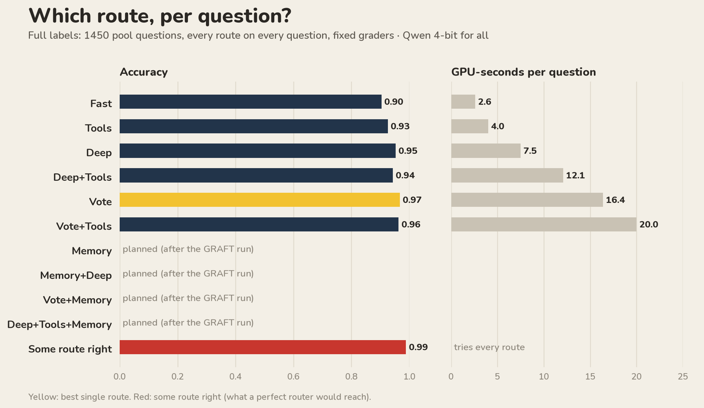

  

<h1 align="center">Flotilla</h1>

<b><a href="docs/reference/PROTOCOL.md">Protocol</a> · <a href="docs/reference/REGISTRY.md">Registry</a> · <a href="docs/reference/run_log.md">Run log</a> · <a href="docs/reference/TESTS.md">Tests</a></b>

<b>One small, quantized open model that picks how to think, per question.</b> 
A compound system on a few H100s, measured on the same benchmarks and settings as published quantized results.

  
  
  
  

---

Flotilla started as a crew of models. The tests cut it to one: Qwen3.8-27B at 4-bit beat the others, and routing
between models added almost nothing. Now the captain (a router) picks a **route** for each question instead: answer
fast, think long, use tools, vote, or recall facts from a knowledge graph. Every rule for keeping or dropping a part
was written down **before** the scored run that decided it, so nothing is tuned on the test set.

## ⚓ At a glance

| | |
|---|---|
| **Model** | Qwen3.8-27B, 4-bit (W4A16, ours), text and images |
| **Small-test mean** | [**0.877**](experiments/test-02-model-small-test/table.csv) over 11 benchmarks |
| **Routes** | Fast, Tools, Deep, Vote, Memory (GRAFT), and combinations |
| **Now** | Route labels done (1,450 questions, fixed graders); LongMemEval and the Memory routes (GRAFT on Qwen, no base graph), router code; then the routers |
| **Dropped** | Command A+ (rule 4.2), gpt-oss-20b (router gain under 1 point) |

## 🧭 How it works

1. **Router.** Reads the question and picks a route or a combination. Trained on questions where every route was tried.
2. **Routes.** Fast (thinking off), Deep (full thinking), Tools (`sympy`, Python, constraint checks), Vote (five
   samples, majority), Memory (facts from a GRAFT knowledge graph).
3. **Verifier.** Runs exact checks first and only asks an LLM when no exact check exists. If it rejects an answer,
   the route gets one retry and is told why.

Every step is logged per question: tokens, GPU time, which route answered, and why.

## 🦆 Why one model

| Test | Question | Result | Decision |
|---|---|---|---|
| [01](experiments/test-01-quantization/README.md) | 4-bit or 8-bit? | Qwen 4-bit [0.984](experiments/test-01-quantization/table.csv), 8-bit [0.984](experiments/test-01-quantization/table.csv) on MATH-500 | Qwen runs 4-bit |
| [02](experiments/test-02-model-small-test/README.md) | Which models? | Qwen [0.877](experiments/test-02-model-small-test/table.csv), gpt-oss [0.772](experiments/test-02-model-small-test/table.csv) (9 text), Command A+ [0.773](experiments/test-02-model-small-test/table.csv) | Command A+ dropped: [−0.104, CI [−0.143, −0.065]](experiments/test-02-model-small-test/rule_4_2.csv) |
| [03](experiments/test-03-router-b-models/README.md) | Route between Qwen and gpt-oss? | Router [0.899](experiments/test-03-router-b-models/table.csv) vs Qwen alone [0.895](experiments/test-03-router-b-models/table.csv) on 476 held-out | gpt-oss dropped |

## 📊 Strategy router (test 04)

The same model, six routes so far, on 1,450 pool questions where every route answered every question, graded with the
fixed verifier and graders.

| Route | Accuracy | Output tokens | GPU-s per question | Cheapest correct |
|---|---|---|---|---|
| Fast | [0.903](experiments/test-04-strategy-router/table.csv) | [2,047](experiments/test-04-strategy-router/table.csv) | [2.6](experiments/test-04-strategy-router/table.csv) | [1,310](experiments/test-04-strategy-router/table.csv) |
| Tools | [0.925](experiments/test-04-strategy-router/table.csv) | [1,969](experiments/test-04-strategy-router/table.csv) | [4.0](experiments/test-04-strategy-router/table.csv) | [75](experiments/test-04-strategy-router/table.csv) |
| Deep | [0.952](experiments/test-04-strategy-router/table.csv) | [4,791](experiments/test-04-strategy-router/table.csv) | [7.5](experiments/test-04-strategy-router/table.csv) | [42](experiments/test-04-strategy-router/table.csv) |
| Deep+Tools | [0.943](experiments/test-04-strategy-router/table.csv) | [5,278](experiments/test-04-strategy-router/table.csv) | [12.1](experiments/test-04-strategy-router/table.csv) | [5](experiments/test-04-strategy-router/table.csv) |
| Vote | [0.967](experiments/test-04-strategy-router/table.csv) | [20,373](experiments/test-04-strategy-router/table.csv) | [16.4](experiments/test-04-strategy-router/table.csv) | [0](experiments/test-04-strategy-router/table.csv) |
| Vote+Tools | [0.963](experiments/test-04-strategy-router/table.csv) | [21,541](experiments/test-04-strategy-router/table.csv) | [20.0](experiments/test-04-strategy-router/table.csv) | [1](experiments/test-04-strategy-router/table.csv) |

**So far:** Vote is the best single route ([0.967](experiments/test-04-strategy-router/table.csv)), but Fast alone is right on [0.903](experiments/test-04-strategy-router/table.csv) at about an eighth of
Vote's GPU time, and some route is right on [98.8%](experiments/test-04-strategy-router/table.csv) of the questions. That is the room a router has, on accuracy
and on compute. Of the 17 questions no route gets right, 10 have a wrong or unanswerable gold
([always wrong](experiments/test-04-strategy-router/runs/run-03/audit/always_wrong.md)). Before the verifier and grader
fixes the same routes scored 0.825 to 0.899
([failure report](experiments/test-04-strategy-router/runs/run-02/audit/failure_report.md)). The four Memory routes
come next: GRAFT on Qwen with no base graph (the full T-REx base halved GRAFT's accuracy, test 05), offered on items that
come with their own history (LongMemEval).

**GRAFT findings (2026-11-21, GRAFT repo):** working memory in the graph is not kept on Haiku (about 1 point over mode C
in two rounds, inside the spread), but writing the steps into the graph beats keeping them in the prompt by 2.6 to 2.7.
Haiku drifted: the exact prompts that scored 38 on 2026-11-13 score about 34 today, with nothing on our side changed;
every paid Haiku batch now starts with that fixed check. GRAFT test 06: using T-REx only as a structure guide (how
relations connect, never as facts) lifts GRAFT from 34.7 to 45.7 on Haiku; Qwen, the model Flotilla ships, is next.

## 📜 Decisions

| Rule | Question | Outcome |
|---|---|---|
| 4.1 | 4-bit or 8-bit? | 4-bit if within 1 point of 8-bit; **Qwen runs 4-bit** |
| 4.2 | Keep Command A+? | **Dropped.** CI of the difference is below 0, on 4× the GPUs |
| v10 | Keep gpt-oss? | **Dropped.** Router gain [+0.004](experiments/test-03-router-b-models/table.csv), under the 1-point bar |
| test 04 | Keep the strategy router? | Pending. Kept if within 1 point of the best fixed route at lower compute, or more than 1 point better |

The full rules, the leakage checks and the changelog are in [`docs/reference/PROTOCOL.md`](docs/reference/PROTOCOL.md); every run and
decision is logged in [`docs/reference/run_log.md`](docs/reference/run_log.md).

## 🧪 Experiments

| Test | Question | Status | Decision |
|---|---|---|---|
| [01 · Quantization](experiments/test-01-quantization/README.md) | Does 4-bit lose accuracy? | done | Qwen runs 4-bit |
| [02 · Model small test](experiments/test-02-model-small-test/README.md) | Which models earn a place? | done | Command A+ dropped |
| [03 · Router B](experiments/test-03-router-b-models/README.md) | Does routing between models help? | done | gpt-oss dropped |
| [04 · Strategy router](experiments/test-04-strategy-router/README.md) | Does picking a route per question help? | running | pending |
| [05 · GRAFT base graph](experiments/test-05-graft-base-graph/README.md) | Does a base knowledge graph help Memory? | done | No base graph: RoG and full T-REx both not adopted |

Index and rules for adding a test: [`experiments/INDEX.md`](experiments/INDEX.md). Charts are drawn only from
[`results/tables/`](results/tables) by [`docs/design/charts.py`](docs/design/charts.py), never from typed numbers.

## 🗺️ Status

- [x] Protocol frozen (v10)
- [x] Leakage checks
- [x] Model choice: Qwen alone (tests 01 to 03)
- [x] Route answers, six routes on 1,500 pool questions
- [x] Fix the verifier and instruction checker, regrade and rerun affected questions
- [ ] Memory routes (GRAFT on Qwen) and their labels
- [ ] Strategy router training, held-out and small test
- [ ] Full benchmark runs: final system and best single route
- [ ] Final report with compute per question

## 📁 What's where

| Path | What it holds |
|---|---|
| `flotilla/` | The system: routes, vote, verifier, tools, scoring, labelling, routers |
| `configs/` | Model servers, system configs per route, data splits |
| `prompts/` | Every prompt, versioned (a change is a new file, never an edit); unused ones in `legacy/` |
| `experiments/` | Numbered tests: README, config, runs, table, figure; `legacy/` for results no decision rests on |
| `results/` | `tables/` (copies of every test table) and `figures/` (charts drawn from them) |
| `reports/` | Leakage checks (`leakage/`: the router pool and LongMemEval, which the labels rest on) |
| `docs/` | `reference/` (PROTOCOL, REGISTRY, run log, PROMPTS, TESTS), `session/` (handoff, status, working setup, project history; the same in GRAFT), `design/` (designs, theme, chart script), `diagrams/` |
| `scripts/` | Cluster setup and job scripts: `trillium/`, `nibi/`, `fir/`, `mac/` |
| `notes/` | Research behind the protocol |
| `tests/` | Unit tests for tools and the system loop |
| `assets/` | Logo |

## License

Apache License 2.0, copyright 2026 Mohamed Khaled. See [`LICENSE`](LICENSE) and [`NOTICE`](NOTICE). Models and tools
downloaded at run time keep their own licenses.
