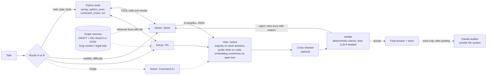

# Flotilla prompts and data flow

Every prompt lives in `prompts/<role>.v<N>.md` with a header giving its role, version, users and output schema. A prompt change is a new file (`v2`), never an edit; each trace line records the prompt versions it used (`PROTOCOL.md` section 7), so prompt changes are ablations like any other component.

## Registry

| File | Role | Called by | Returns |
|---|---|---|---|
| `router.v1.md` | route a task to task type, tools, models, difficulty | router A / B (classifiers emit the same fields); LLM-router ablation | JSON `{task_type, tools, models, difficulty}` |
| `solver.v1.md` | solve the task (plus per-task-type additions) | Qwen, Phi, Command A+ | free reasoning, then JSON `{final_answer, confidence, sources, tool_calls}` |
| `cross_checker.v1.md` | review another model's answer | a second solver model (loop ablation) | JSON `{agree, issue, corrected_answer, confidence}` |
| `verifier.v1.md` | accept or reject before returning | deterministic checks first, LLM only when no exact check exists | JSON `{verdict, checks, reason}` |
| `auditor_claude.v1.md` | explain correctness and error stage | Claude, outside the system, never feeds answers | JSON `{correct, error_stage, explanation}` |
| benchmark standard prompts | single-model baseline rows | lm-eval-harness / lmms-eval task configs, unchanged | as each benchmark defines |

## Flow

Solid lines are always on; dotted lines are components switched by the ablations.

## Output contract

- Solvers reason in free text and end with exactly one JSON block. The parser takes the last JSON block; if none parses, the item is scored with error stage `format_parse_failure` (no silent retries).
- The vote compares `final_answer` fields after normalization (numbers: sympy-equal; letters: case-folded; code: selected by public tests, not by text).
- `confidence` is logged and used for calibration plots; it never overrides the vote.
- Every model call logs prompt tokens, generated tokens and latency (`PROTOCOL.md` section 8).
